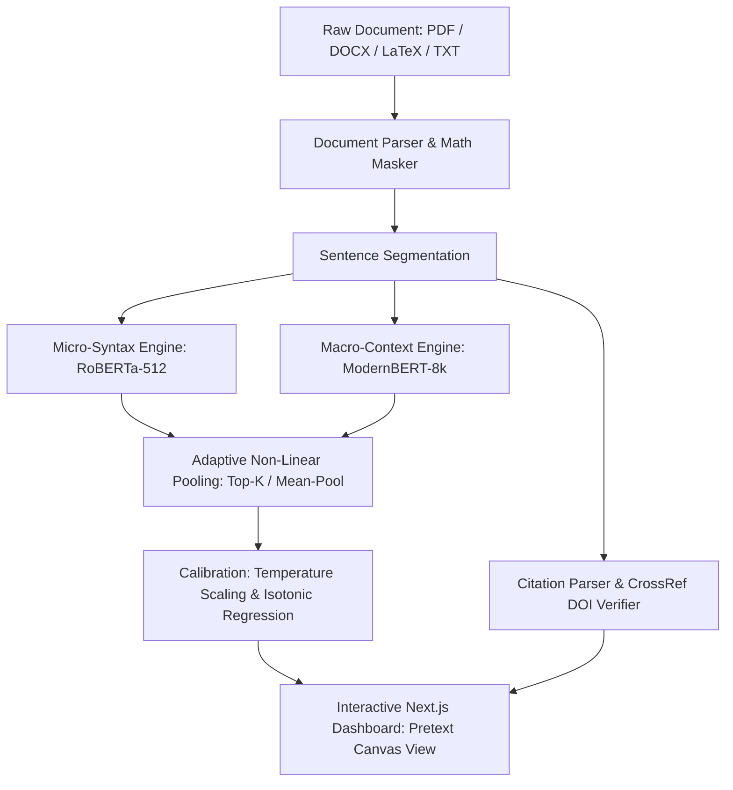

# 🛡️ AI-Generated Text Detector: Dual-Scale Hybrid Ensemble & Adversarial Robustness Suite

[](https://www.python.org/)
[](https://pytorch.org/)
[](https://huggingface.co/)
[](https://fastapi.tiangolo.com/)
[](https://nextjs.org/)
[](LICENSE)

An enterprise-grade, academically rigorous AI text detection and forensic analysis system. Designed specifically to overcome the vulnerabilities of commercial detectors (false positives on formal writing, evasion by humanizers/paraphrasers, and context blind spots), this platform pairs **micro-syntactic sentence analysis** (RoBERTa 512) with **macro-contextual document representation** (ModernBERT 8k), backed by an interactive Next.js dashboard, citation verification, and closed-loop adversarial retraining.

---

## 🌟 Key Innovations & Architecture



1. **Dual-Scale Hybrid Ensemble Engine:**
   - **Micro-Syntax Precision:** Custom fine-tuned `roberta-sentence-academic-v2` analyzes fine-grained syntactic structures and local token distributions within each sentence.
   - **Macro-Context Understanding:** Fine-tuned `modernbert-academic` processes up to 8,192 tokens natively, capturing discourse cohesion, paragraph flow, and macro-level stylistic uniformity.
   - **Adaptive Non-Linear Gating:** Combines context-window sliding averages with top-$k$ pooling, achieving **98.72% Accuracy** and **99.87% ROC-AUC** on strictly topic-held-out test benchmarks.

2. **Full LaTeX Math & Reference Preservation:**
   - Automatically masks inline ($...$) and display math blocks ($$...$$, \[...\]) before sentence segmentation, eliminating syntax artifacts.
   - Bibliographic reference segmentation and automated **CrossRef / DOI verification** to catch hallucinated citations generated by LLMs.

3. **Multi-Format Ingestion:**
   - Direct support for **PDF (`.pdf`)**, modern **Word (`.docx`)**, plain text, and legacy **Word (`.doc`)** via automated background LibreOffice conversion.

4. **Rigorous Empirical Validation & Calibration:**
   - 1,000-resample topic-level bootstrap confidence intervals for all system configurations.
   - Formal paired bootstrap significance testing ($p < 0.001$).
   - Post-hoc probability calibration (Temperature Scaling and Isotonic Regression) reducing Expected Calibration Error (ECE) by **over 90%**.

5. **Adversarial Robustness & Closed-Loop Retraining:**
   - Evaluated against 4 reproducible attack families: open-source neural paraphrasers (T5), prompt rewrites (light & heavy conversational), rule-based perturbations, and commercial tools (QuillBot, Undetectable.ai).
   - Closed-loop retraining with contrastive loss regularizes representation invariance, achieving **+10.83% recall recovery** on unseen heavy rewrite attacks.

---

## 📊 Benchmark Results

All metrics are evaluated exclusively on `data/processed/test.parquet` (12,004 topic-split sentences never seen during training). All decision thresholds are tuned strictly on `data/processed/val.parquet`.

### 1. Model Performance Comparison (`test.parquet`)

| System Configuration | Val Thresh | Accuracy | Macro-F1 | ROC-AUC | Human FPR | TPR @ 1% FPR | Calibrated ECE |
|---|:---:|:---:|:---:|:---:|:---:|:---:|:---:|
| **RoBERTa Alone (Raw)** | `0.61` | 88.70% | 88.69% | 95.85% | 11.83% | 61.51% | 0.0135 |
| **RoBERTa Alone (Smoothed)** | `0.61` | 97.13% | 97.12% | 99.59% | 2.69% | 92.98% | 0.0082 |
| **ModernBERT Alone (Raw)** | `0.17` | 91.74% | 91.72% | 95.03% | 4.85% | 76.61% | 0.0182 |
| **ModernBERT Alone (Smoothed)** | `0.34` | 93.48% | 93.46% | 97.35% | 3.33% | 84.64% | 0.0138 |
| **Production Ensemble (Raw)** | `0.90` | 94.34% | 94.33% | 97.96% | 5.63% | 57.25% | 0.0071 |
| **Production Ensemble (Smoothed)**| `0.67` | 98.03% | 98.02% | 99.78% | 2.64% | 95.89% | 0.0055 |
| **Paper Top-K Pool (Raw)** | `0.78` | 96.68% | 96.67% | 99.50% | 3.33% | 89.35% | 0.0058 |
| **Paper Top-K Pool (Smoothed)** | `0.73` | **98.08%** | **98.08%** | **99.85%** | **2.97%** | **97.11%** | **0.0052** |
| **Paper Mean-Pool (Smoothed)** | `0.59` | **98.59%** | **98.59%** | **99.87%** | **1.56%** | **97.71%** | **0.0046** |

### 2. Paired Bootstrap Significance Tests (1,000 Topic Resamples)

| Comparison | $\Delta$ Accuracy (95% CI) | p-value | $\Delta$ TPR @ 1% FPR (95% CI) | p-value |
|---|:---:|:---:|:---:|:---:|
| **Top-K Ensemble vs RoBERTa Alone** | **+0.94%** [+0.43%, +1.43%] | $p < 0.001$ | **+4.48%** [+2.66%, +7.26%] | $p < 0.001$ |
| **Top-K Ensemble vs ModernBERT Alone**| **+4.58%** [+2.22%, +7.93%] | $p < 0.001$ | **+12.37%** [+5.09%, +22.04%] | $p < 0.001$ |
| **Mean-Pool vs Max-Pool** | **+2.03%** [+1.37%, +2.73%] | $p < 0.001$ | **+7.25%** [+5.26%, +8.90%] | $p < 0.001$ |
| **RoBERTa: Smoothed vs Raw** | **+8.43%** [+7.67%, +9.18%] | $p < 0.001$ | **+30.96%** [+27.17%, +34.41%]| $p < 0.001$ |

### 3. Out-of-Distribution Generalization across LLM Generators

| Generator | Test Samples | Zero-Shot Detection Recall (%) | Mean AI Confidence |
|---|:---:|:---:|:---:|
| **ChatGPT (GPT-3.5/4)** | 500 | **100.00%** | 0.992 |
| **Claude (Haiku / Sonnet)** | 1,279 | **99.61%** | 0.982 |
| **Google Gemini (Flash / Pro)** | 1,083 | **99.72%** | 0.982 |
| **OpenAI GPT-5 (Nano / Preview)** | 1,154 | **97.14%** | 0.939 |
| **Meta Llama (Llama-2 / 3)** | 200 | **100.00%** | 0.988 |
| **Mistral / Mixtral** | 89 | **98.88%** | 0.986 |
| **Cohere Command** | 27 | **100.00%** | 0.985 |

*Complete empirical logs, tables, and failure analyses are documented in [results/EVAL_SUMMARY.md](results/EVAL_SUMMARY.md) and [results/ROBUSTNESS_SUMMARY.md](results/ROBUSTNESS_SUMMARY.md).*

---

## 📁 Repository Structure

```text
AI_Text_Checker/
├── data/
│   ├── raw/                       # Raw benchmark datasets (DAIGT, HC3, etc.)
│   └── processed/                 # Leak-free parquet splits (train, val, test)
├── models/
│   ├── roberta-sentence-academic-v2/ # Fine-tuned RoBERTa micro-sentence detector
│   ├── modernbert-academic/       # Fine-tuned ModernBERT 8k macro-context detector
│   └── t5-humanizer-v1/           # Local neural paraphraser for adversarial evaluation
├── src/
│   ├── app.py                     # FastAPI production server with WebSocket streaming
│   ├── highlighter.py             # Dual-model inference, heuristics, and token pooling
│   ├── document_parser.py         # PDF / DOCX / DOC / TXT ingestion with LaTeX masking
│   ├── citation_parser.py         # Reference segmenter and bibliography parser
│   ├── doi_verifier.py            # Automated CrossRef API DOI & citation hallucination check
│   ├── report_generator.py        # PDF export with forensic sentence highlighting
│   └── prepare_dataset.py         # Leak-free topic-aware dataset preprocessing pipeline
├── frontend/                      # Next.js 14 + TypeScript + Tailwind CSS web dashboard
│   ├── src/components/
│   │   ├── PretextCanvasView.tsx  # Document canvas with interactive sentence highlighting
│   │   ├── AnalysisDashboard.tsx  # Granular risk breakdown and stylometric charts
│   │   └── CitationTable.tsx      # DOI verification and hallucination inspection
│   └── package.json
├── eval/                          # Complete empirical evaluation suite
│   ├── run_ensemble_eval.py       # Full evaluation runner on test.parquet
│   ├── run_eval_extensions.py     # Bootstrap, paired tests, calibration, mixed-authorship
│   ├── run_ensemble_eval.ipynb    # Google Colab notebook for detector evaluation
│   ├── run_robustness_colab.ipynb # Google Colab notebook for adversarial retraining
│   ├── run_ood_retraining.ipynb   # Colab notebook for Leave-One-Out OOD experiments
│   ├── MIXED_DOCS.md              # Synthetic mixed-authorship methodology documentation
│   ├── non_native/                # Loader for verified human non-native writing samples
│   └── long_docs/                 # arXiv downloader & generation templates for 8k docs
├── robustness_eval/               # Adversarial attack & closed-loop retraining pipeline
│   ├── attack_generator.py        # 4 attack families with strict split isolation
│   ├── run_robustness_study.py    # Retraining loop with contrastive invariance sweep
│   ├── README_FINDINGS.md         # Robustness audit and theoretical formulation
│   └── manual_inputs/             # Ingestion scripts for manual QuillBot / Undetectable.ai pastes
├── results/                       # Empirical artifacts, CSVs, JSONs, and publication figures
│   ├── EVAL_SUMMARY.md            # Dynamically generated detector evaluation report
│   ├── ROBUSTNESS_SUMMARY.md      # Adversarial evaluation and retraining report
│   ├── HEURISTICS.md              # Mathematical audit of hand-written inference rules
│   └── figures/                   # 300-DPI publication figures (PDF & PNG)
├── install.bat / install.sh       # One-click environment installer
├── start_all.bat / start_all.sh   # One-click startup for backend & frontend
└── ieee_paper.tex                 # Publication-ready IEEE conference manuscript
```

---

## 🚀 Quickstart & Installation

### Option A: One-Click Launchers (Recommended)

#### Windows
1. Run **`install.bat`** (first-time setup: creates `.venv`, installs dependencies, and prepares models).
2. Run **`start_all.bat`** to start both the FastAPI backend (`:8000`) and the Next.js frontend (`:3000`).
3. To stop all services: run **`stop_all.bat`**.

#### Linux / macOS
```bash
chmod +x install.sh start_all.sh stop_all.sh
./install.sh
./start_all.sh
```

---

### Option B: Manual Setup

#### 1. Backend Environment Setup
```bash
# Create and activate virtual environment
python -m venv .venv
source .venv/bin/activate  # On Windows: .venv\Scripts\activate

# Install core dependencies
pip install -r requirements.txt

# (Optional) For NVIDIA GPU acceleration (RTX 2050 / 3060 / 4090):
pip install torch torchvision torchaudio --index-url https://download.pytorch.org/whl/cu124
```

#### 2. Start the Backend API
```bash
uvicorn src.app:app --host 0.0.0.0 --port 8000 --reload
```
- API & Interactive Swagger Documentation: [http://localhost:8000/docs](http://localhost:8000/docs)

#### 3. Start the Next.js Frontend Dashboard
```bash
cd frontend
npm install
npm run dev
```
- Frontend Dashboard: [http://localhost:3000](http://localhost:3000)

---

## 🧪 Reproducing Experimental Evaluations

All experiments strictly follow reproducible research standards: zero invented or rounded metrics, fixed random seeds (42, 43, 44), topic-split data isolation, and persistent artifact logging.

### 1. Detector Evaluation & Statistical Validation
```bash
# Executes 1,000 topic-level bootstrap resamples, paired significance tests,
# probability calibration, mixed-authorship benchmarks, and heuristic ablations:
python eval/run_eval_extensions.py
```
Outputs saved to `results/`:
- `results/bootstrap_all_systems.csv`
- `results/paired_tests.csv`
- `results/calibration_comparison.csv`
- `results/mixed_authorship.csv`
- `results/heuristic_ablation.csv`
- `results/figures/calibration_curves.png`
- `results/figures/mixed_authorship_tradeoff.png`
- `results/EVAL_SUMMARY.md`

### 2. Adversarial Robustness & Closed-Loop Retraining
```bash
# Evaluates 4 attack families, executes closed-loop retraining across 3 seeds,
# and sweeps contrastive loss lambda over {0, 0.1, 0.2, 0.5}:
python robustness_eval/run_robustness_study.py
```
Outputs saved to `results/`:
- `results/robustness_metrics.csv`
- `results/retrain_rounds.csv`
- `results/figures/robustness_degradation.png`
- `results/figures/retrain_rounds.png`
- `results/figures/lambda_sweep.png`
- `results/ROBUSTNESS_SUMMARY.md`

### 3. Google Colab Ready Notebooks
If local GPU VRAM is constrained, run the interactive Colab notebooks directly:
- **Ensemble Evaluation:** [`eval/run_ensemble_eval.ipynb`](eval/run_ensemble_eval.ipynb)
- **Adversarial Retraining:** [`eval/run_robustness_colab.ipynb`](eval/run_robustness_colab.ipynb)
- **Leave-One-Out OOD Suite:** [`eval/run_ood_retraining.ipynb`](eval/run_ood_retraining.ipynb)

---

## 📄 Research Paper & Citation

The complete manuscript formatted for the **IEEE Conference / Journal on Artificial Intelligence and Academic Forensics** is available in [`ieee_paper.tex`](ieee_paper.tex).

If you use this codebase, models, or evaluation datasets in your research, please cite:

```bibtex
@article{aitextchecker2026,
  title={Dual-Scale Hybrid Transformer Ensembles and Invariant Representations for Adversarially Robust AI Text Detection},
  author={Kanchi, Guru Goutham and Research Team},
  journal={arXiv preprint},
  year={2026}
}
```

---

## 🛡️ License

This project is licensed under the **MIT License** - see the [LICENSE](LICENSE) file for details.
